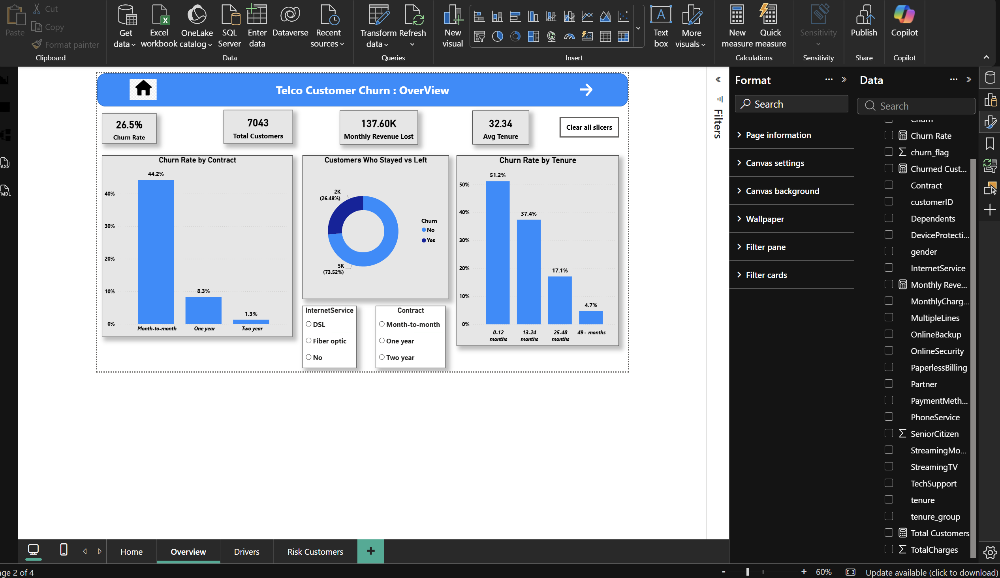
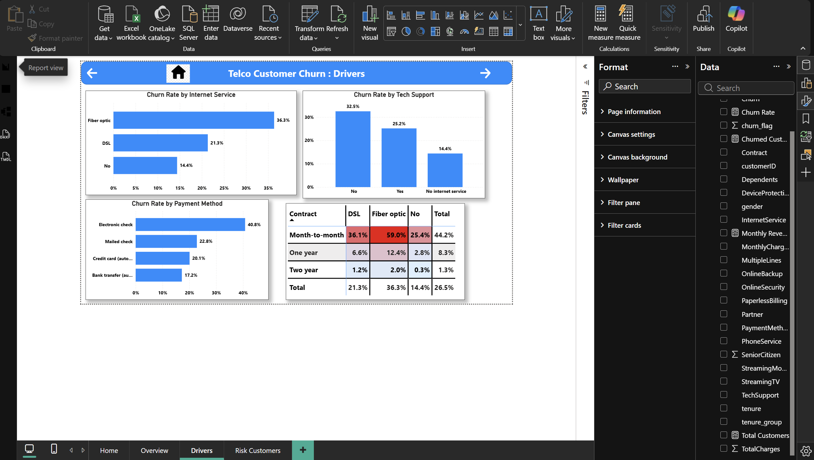
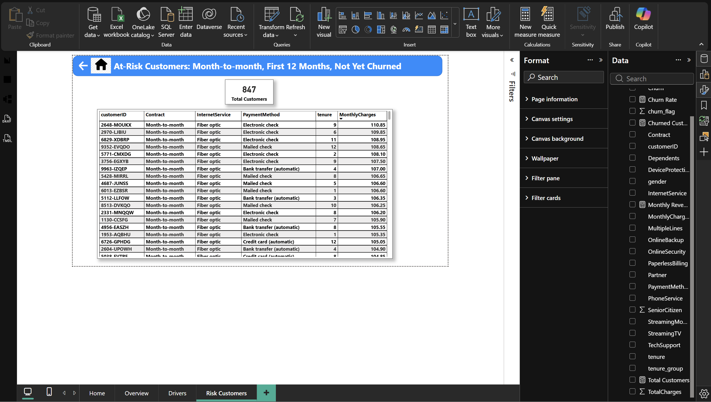

# Telco Customer Churn Analysis

An end-to-end analysis of why telecom customers leave, built with **SQL, Python and Power BI**. The project goes from raw data to cleaning, analysis, a 3-page dashboard and business recommendations.

## Business Problem

A telecom company is losing about 26.5% of its customers. This project finds which customers are leaving, why they are leaving, and what the company can do to keep them.

## Dataset

Synthetic dataset modelled on the public Telco Customer Churn schema: **7,043 customers and 21 columns** covering demographics, services, contract, billing and churn status.

| Group | Columns |
|---|---|
| Customer | customerID, gender, SeniorCitizen, Partner, Dependents |
| Account | tenure, Contract, PaperlessBilling, PaymentMethod, MonthlyCharges, TotalCharges |
| Services | PhoneService, MultipleLines, InternetService, OnlineSecurity, OnlineBackup, DeviceProtection, TechSupport, StreamingTV, StreamingMovies |
| Target | Churn (Yes / No) |

## Tools Used

- **MySQL** for data cleaning and analysis
- **Python** (pandas, seaborn, matplotlib) in Jupyter Notebook
- **Power BI** (DAX measures, slicers, page navigation) for the dashboard
- **GitHub** for version control

## Process

1. Imported the data into MySQL and checked quality (duplicates, nulls, allowed values).
2. Fixed 11 blank TotalCharges values (new customers with zero tenure) and created a clean view with `churn_flag` and `tenure_group` columns.
3. Analysed churn with SQL using GROUP BY, CASE WHEN, CTEs, RANK() and NTILE().
4. Confirmed the findings with charts in Python.
5. Built a 3-page Power BI dashboard: Overview, Drivers and At-Risk Customers.
6. Turned the results into findings and recommendations.

## Key Findings

- Overall churn is **26.5%** (1,865 of 7,043 customers).
- Month-to-month customers churn at **44.2%**, versus 8.3% for one-year and 1.3% for two-year contracts.
- Churn is **51.2%** in the first 12 months and falls to 4.7% after 48 months.
- Fiber optic customers churn at **36.3%**, versus 21.3% for DSL.
- Customers without tech support churn at 32.5%, versus 25.2% with it.
- Electronic check users churn at **40.8%**, the highest of all payment methods.
- Month-to-month customers with Fiber optic are the riskiest group, at **59.0%** churn.
- Churn costs about 137,600 per month (roughly 1.65 million per year) in lost recurring revenue.

## Recommendations

1. Offer discounts or upgrades to move month-to-month customers onto one-year plans.
2. Start a 90-day welcome program for new customers.
3. Bundle tech support and online security with fiber plans.
4. Encourage automatic payments with a small bill discount.
5. Use the At-Risk Customers list (847 customers) for proactive retention calls.

If retention actions reduce churn by 10%, the company would save an estimated 165,000 per year. This is an estimate based on that assumption.

## Dashboard Screenshots

### Overview
KPI cards (churn rate, total customers, monthly revenue lost, average tenure), churn by contract and by tenure, with slicers for contract and internet service.

### Churn Drivers
Churn rate by internet service, tech support and payment method, plus a heat map of contract by internet service.

### At-Risk Customers
847 current customers on month-to-month contracts with 12 months or less of tenure who have not churned yet.

## Repository Structure

| File | Description |
|---|---|
| `telco_customer_churn.csv` | Raw dataset (7,043 customers, 21 columns) |
| `telco_customer_clean.csv` | Cleaned data exported from the `customers_clean` SQL view |
| `telco_churn_queries.sql` | SQL for setup, cleaning and analysis |
| `telco_customer_churn.ipynb` | Python analysis notebook |
| `telco_churn.pbix` | Power BI dashboard |
| `overview.png`, `drivers.png`, `risk_customers.png` | Dashboard screenshots |
| `telco_customer_churn_insights.txt` | Written insights and recommendations |

## How to Reproduce

1. Create a MySQL schema and import `telco_customer_churn.csv` into a table called `customers`.
2. Run `telco_churn_queries.sql` to clean the data and create the `customers_clean` view.
3. Export `customers_clean` to CSV and run `telco_customer_churn.ipynb`.
4. Open `telco_churn.pbix` in Power BI Desktop and refresh the data source.

## Skills Demonstrated

SQL (CTEs, window functions, CASE WHEN, views), data cleaning, exploratory analysis in Python, DAX measures, dashboard design, and turning data into business recommendations.

## Limitations

- The dataset is synthetic, so the exact numbers are illustrative.
- The findings show associations, not proof of cause. A pilot test would be needed to confirm that the recommended actions reduce churn.

## Author

**Jawahar Chandru**: [GitHub](https://github.com/JawaharChandru)
